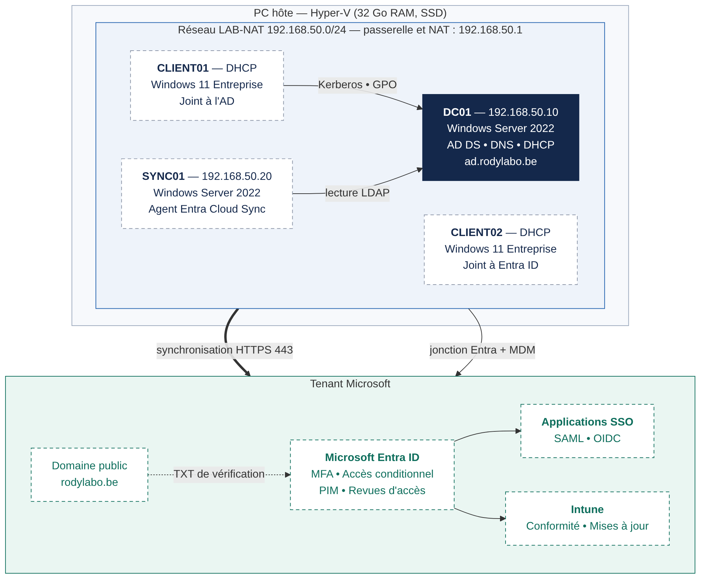

# Labo IAM hybride — Active Directory + Microsoft Entra ID + Intune

Sécurisation des identités de **RODy**, une entreprise fictive de 100 collaborateurs,
dans un labo hybride construit de zéro.

➡️ Architecture détaillée (infrastructure, structure AD, modèle AGDLP) : [docs/00-architecture.md](docs/00-architecture.md)

## Objectif
Démontrer les compétences d'un administrateur IAM : gestion des identités on-premise,
synchronisation vers le cloud, authentification forte, Zero Trust, privilèges et gouvernance.

## Avancement
| Phase | Sujet | État |
|---|---|---|
| 01 | Réseau Hyper-V (NAT) et création des VM | ✅ |
| 02 | Contrôleur de domaine, OU, 100 comptes, groupes AGDLP, mots de passe, GPO, DHCP | ✅ |
| 03 | Jonction des postes, tiering, LAPS | 🚧 |
| 04 | Synchronisation vers Entra ID (Cloud Sync) | ⏳ |
| 05 | MFA et accès conditionnel | ⏳ |
| 06 | SSO : SAML et OpenID Connect | ⏳ |
| 07 | Intune et postes conformes | ⏳ |
| 08 | PIM et revues d'accès | ⏳ |
| 09 | Automatisation PowerShell / Microsoft Graph | ⏳ |
| 10 | Audit et détection | ⏳ |

## Réalisé jusqu'ici
- Forêt Active Directory `ad.rodylabo.be` (Windows Server 2022), DNS avec redirecteurs, suffixe UPN `rodylabo.be`
- 16 unités d'organisation : services métiers, admins par tier (Tier 0/1/2), comptes de service
- 100 comptes générés et importés par script, avec hiérarchie managériale
- Groupes selon le modèle **AGDLP**
- Stratégie de mots de passe (12 caractères) et **PSO** renforcée pour les admins (16 caractères)
- GPO de sécurité : LLMNR désactivé, verrouillage de session, pare-feu forcé, audit avancé
- Serveur DHCP autorisé dans l'AD

## Environnement
Hyper-V • Windows Server 2022 • Windows 11 Entreprise • tenant Microsoft Entra ID

## Contenu du dépôt
- `scripts/ad/` : scripts PowerShell de création des comptes
- `docs/` : documentation, architecture et rapports de GPO
- `diagrams/` : schémas d'architecture
- `screenshots/` : captures par phase
- `journal.md` : journal de bord

## Auteur
Rody — Junior IAM / Identity Security | CCNA • AZ-104 • MD-102 • SC-300 (en cours)
[LinkedIn](https://www.linkedin.com/in/tchambia-ngandeu-rodi-herman)
