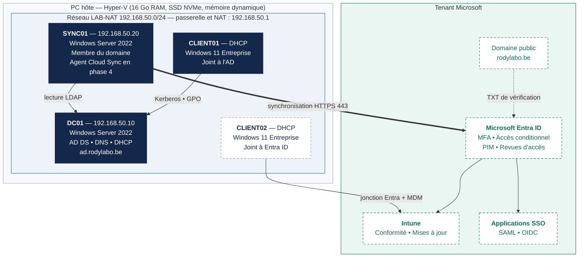
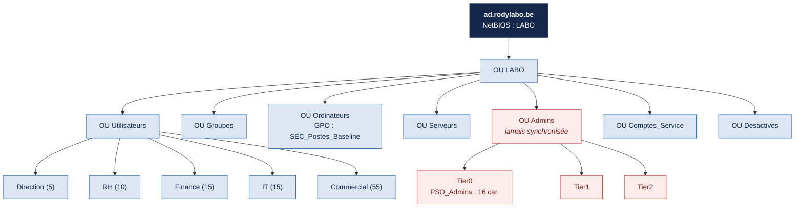
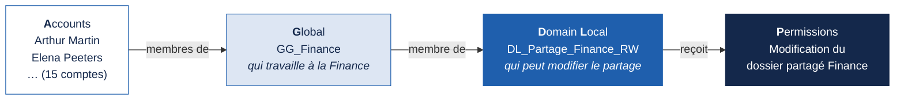

# Architecture du labo IAM hybride — RODy

Ce document décrit l'architecture du labo : l'infrastructure (machines et réseau),
la structure de l'annuaire Active Directory et le modèle de groupes AGDLP.

> **Légende** — bloc **plein foncé** : déjà en place • bloc **en pointillés** : prévu dans les phases suivantes.

## 1. Infrastructure

| Machine | Système | Adresse | Rôle |
|---|---|---|---|
| **DC01** | Windows Server 2022 | 192.168.50.10 (fixe) | Contrôleur de domaine `ad.rodylabo.be` : AD DS, DNS, DHCP |
| **SYNC01** | Windows Server 2022 | 192.168.50.20 (fixe) | Serveur membre (OU Serveurs) — accueillera l'agent Microsoft Entra Cloud Sync |
| **CLIENT01** | Windows 11 Entreprise | DHCP (192.168.50.100) | Poste joint à l'AD (OU Ordinateurs), géré par GPO |
| **CLIENT02** | Windows 11 Entreprise | DHCP (.100 à .150) | Poste joint à Entra ID, géré par Intune |

**Hôte** : portable 16 Go de RAM, SSD NVMe. Les VM utilisent la **mémoire dynamique** Hyper-V et ne sont démarrées que lorsqu'elles sont nécessaires.

**Réseau** : commutateur Hyper-V interne `LAB-NAT` avec NAT sur l'hôte. Les VM sont isolées du réseau
domestique mais accèdent à Internet (indispensable pour joindre Microsoft Entra ID).
L'agent de synchronisation n'ouvre aucun port entrant : il communique uniquement en sortie (HTTPS 443).

**Identité** : domaine AD `ad.rodylabo.be` (NetBIOS `LABO`), suffixe UPN public `rodylabo.be`.
Les utilisateurs se connectent avec `prenom.nom@rodylabo.be`, identique en local et dans le cloud.

## 2. Structure de l'annuaire Active Directory

- **Une OU par service** sous `Utilisateurs` : ce sont les OU synchronisées vers Entra ID.
- **`Admins` n'est jamais synchronisée** : un compte à privilèges de l'AD ne doit pas exister dans le cloud.
- **Tiering** (Tier 0/1/2) : un compte d'administration Tier 0 ne se connecte jamais sur un poste Tier 2.
- **`Ordinateurs`** reçoit la GPO `SEC_Postes_Baseline` (LLMNR désactivé, verrouillage après 10 min, pare-feu forcé, audit avancé).
- Stratégie de mots de passe du domaine : 12 caractères, verrouillage après 10 essais.
  **PSO_Admins** pour les administrateurs : 16 caractères, verrouillage après 5 essais.

## 3. Modèle de groupes AGDLP

Les **comptes** sont membres de groupes **globaux** (par métier), eux-mêmes membres de groupes
**domaine local** (par ressource), qui seuls reçoivent les **permissions**.
Quand un employé change de service, on le change simplement de groupe global : ses droits suivent automatiquement.

| Service | Groupe global | Groupe domaine local | Membres |
|---|---|---|---|
| Direction | GG_Direction | DL_Partage_Direction_RW | 5 |
| RH | GG_RH | DL_Partage_RH_RW | 10 |
| Finance | GG_Finance | DL_Partage_Finance_RW | 15 |
| IT | GG_IT | DL_Partage_IT_RW | 15 |
| Commercial | GG_Commercial | DL_Partage_Commercial_RW | 55 |
